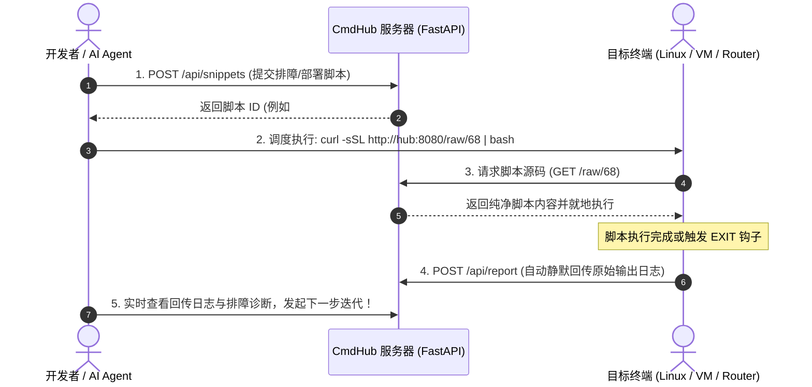

# CmdHub 🚀
**跨终端命令极速分发与双向自动化日志回传中转站**  
*A Lightweight, Cross-Device Command Dispatching & Bi-Directional Telemetry Hub for Developers and AI Agents.*

---

[](LICENSE)
[](https://www.python.org/)
[](https://fastapi.tiangolo.com/)
[](Dockerfile)
[](#)

---

## 🌟 诞生背景 (Why CmdHub?)

在跨机器调试（远程服务器、边缘设备、开发板、路由器、虚拟机如 ARCVM / WSL）或与 **AI 编程智能体 (AI Agent)** 协同排障时，开发者经常遭遇两大痛点：
1. **繁琐的手动复制**：跨设备输入复杂的长脚本、转义符和多行命令极易出错。
2. **割裂的反馈闭环**：终端执行出错后，开发者必须再次人肉截屏或复制大量终端输出给 AI 或队友，极度浪费精力。

**CmdHub 正是为解决这一闭环而生**：
- **单行极速拉取执行**：目标终端只需运行 `curl -sSL http://<server>:8080/raw/<id> | bash` 即可无感执行。
- **全自动双向回传**：脚本执行结束时（无论成功还是报错），底层原始标准输出与错误日志自动打包装载并 HTTP POST 回传 CmdHub。
- **AI 智能体无缝驱动**：AI Agent 可通过 REST API 自动提交待测脚本并直接读取机器回传的日志，实现全自主自动化排障闭环！

---

## 🏗️ 架构图与协作流 (Architecture)



---

## ✨ 核心特性 (Key Features)

- ⚡ **极速单行运行 (One-Liner Execution)**：
  每个代码片段均生成原生轻量链接，支持一键复制 `curl -sSL ... | bash`。
- 🔄 **双向日志自动遥测 (Two-Way Telemetry)**：
  内置原生 `/api/report` 接口，支持客户端以二进制流静默上传终端完整执行回执，免去 JSON 转义的繁琐。
- 🎯 **多项目 / 多设备分舱隔离 (Project Scoping)**：
  按项目、机型或服务分类归档（如 `servers`、`edge-devices`、`iot`），支持一键筛选与全局置顶。
- 🎨 **零外网依赖暗色主题 (Zero-CDN Pure CSS UI)**：
  全部界面采用内嵌的 GitHub Dark 风格精简 CSS，**不依赖任何外部 CDN**，即使在完全隔离的局域网或内网离线机房中也能秒开。
- 🐳 **开箱即用与跨平台**：
  提供 Dockerfile、docker-compose、Python 原生启动脚本（`start.sh` 与 `start.bat`），单文件 SQLite 存储，零外部数据库依赖。

---

## 🚀 快速上手 (Quick Start)

### 方式一：Docker 运行 (推荐)

```bash
# 1. 克隆仓库
git clone https://github.com/ignativs1/cmdhub.git
cd cmdhub

# 2. 一键启动
docker-compose up -d
```
启动后访问：`http://localhost:8080`

---

### 方式二：本地 Python 运行

```bash
# 1. 安装依赖
pip install -r requirements.txt

# 2. 启动服务 (Windows 亦可直接双击 start.bat)
python app.py
```
终端会输出当前宿主机的局域网 IP，局域网内任意终端均可访问！

---

## 💡 黄金实践：双向全自动执行脚本模板

在 CmdHub 提交脚本时，只需包裹以下 3 行标准 Bash 结构，即可让目标终端执行时自动将所有输出回传给开发者：

```bash
#!/bin/bash
LOG_FILE="/tmp/task_run.log"
SERVER="http://192.168.1.177:8080"  # 您的 CmdHub IP

# 无论命令成功退出或中途出错，EXIT 时均自动静默回传日志
trap 'curl -s -X POST --data-binary @"$LOG_FILE" "${SERVER}/api/report?project=servers&title=系统自动巡检报告"' EXIT

{
    echo "==================== [执行开始] ===================="
    date
    echo "--- 检查磁盘剩余空间 ---"
    df -h
    echo "--- 检查内存使用率 ---"
    free -m
    echo "==================== [执行结束] ===================="
} 2>&1 | tee "$LOG_FILE"
```

在目标机器上仅需一行：
```bash
curl -sSL http://192.168.1.177:8080/raw/1 | bash
```
跑完后刷新 CmdHub 网页，完整的执行结果已经整整齐齐地记录在数据库中！

---

## 🛠️ CLI 客户端工具使用 (`cmdhub_cli.py`)

仓库内置轻量级命令行工具，方便集成到 Shell 或自动化脚本中：

```bash
# 推送一个本地脚本文件
python cmdhub_cli.py push -p servers -t "备份数据库" -f ./backup.sh --pin

# 直接推送一段命令行
python cmdhub_cli.py push -p general -t "重启网络" -c "sudo systemctl restart networking"

# 查看指定项目的所有命令与日志回执
python cmdhub_cli.py list -p servers

# 查看指定 ID 的纯脚本内容
python cmdhub_cli.py cat 1
```

---

## 📡 核心 API 接口速查

| 接口 | 方法 | 说明 |
| :--- | :--- | :--- |
| `/p/{project}` | `GET` | 访问项目专区 Web 界面（支持置顶、筛选、创建） |
| `/raw/{id}` | `GET` | 获取纯文本脚本内容（供 `curl \| bash` 直接执行） |
| `/api/snippets` | `POST` | 创建命令片段 (`{project, title, content, language, is_pinned}`) |
| `/api/report` | `POST` | **双向日志自动上报**（直接接收 `--data-binary` 终端输出流） |
| `/api/snippets` | `GET` | 查询片段列表（支持 `?project=xxx&limit=xx`） |
| `/api/projects` | `GET` | 获取当前所有项目及片段数量统计 |
| `/health` | `GET` | 健康检查与当前服务器局域网 IP 探测 |

---

## 📄 开源许可证

本项目基于 [MIT 许可证](LICENSE) 开源。欢迎 Star、Fork 与提交 Issue！
